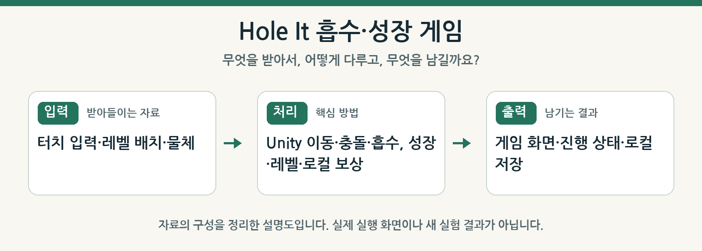
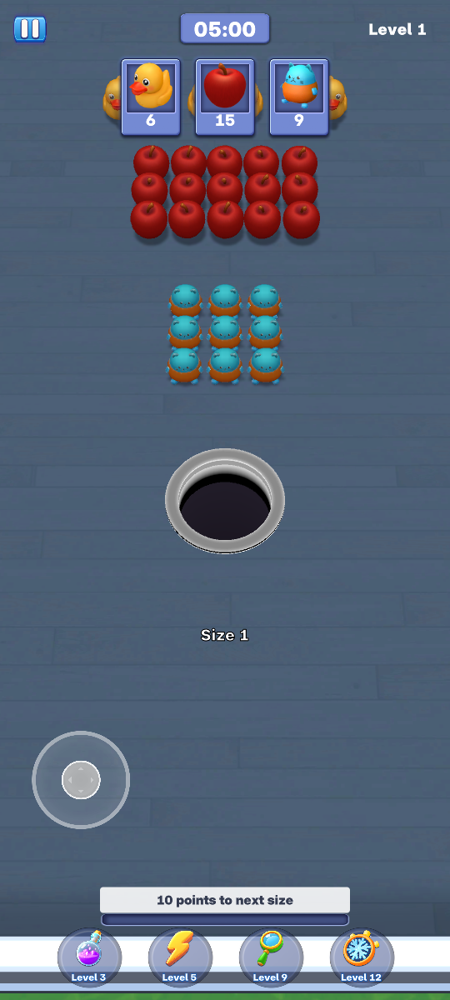
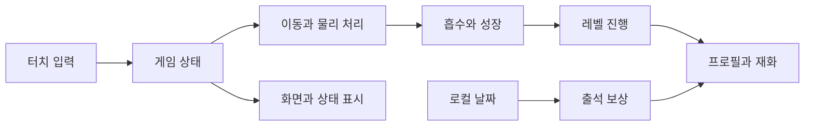

<div align="center">

# 🕳️ Hole It Project

물체를 흡수하며 성장하는 Unity 게임입니다.

**기술 분류:** 게임 프로그래밍 › Unity 게임플레이 › 물리·흡수·성장·상태


[빠른 시작](#quick-start) · [저장소 구성](#repository-structure) · [게임 설정](#data-settings)

[예시 이미지](#preview)

</div>

<a name="overview"></a>

## 🗺️ 한눈에 보는 구성

<p align="center"></p>
보관한 프로젝트 자료의 흐름을 정리한 설명도입니다.

<a name="latest-changes"></a>
## ✨ 최신차수에서 달라진 점

**8차 · 최신보관본** — 실제 수집 트리거·지연 성장과 열린 원형 게이지

- 모든 배치 물체의 강체·충돌체를 유지하고 ReferencePhysicsTrigger의 진입·이탈 이벤트를 전달합니다. 프레임당 활성화 25개를 전체 강체 수 제한으로 해석하지 않습니다.
- ReferenceGrowthProgress는 목표·적용 성장 단계를 구분하고 0.3초 뒤 성장시키며 ReferenceGrowthRing은 열린 원형 게이지를 그립니다. 수집 뒤 강체 렌더 유지·승리 후 물리 갱신·전체 bounds 시야 검사가 7차와 다릅니다.

[🔍 최신 자료 자세히 보기](docs/versions/8%EC%B0%A8.md) · [🗂️ 전체 차수 의미 비교](docs/VERSIONS.md)

### 🧭 차수 바로가기

[1차](docs/versions/1%EC%B0%A8.md) · [2차](docs/versions/2%EC%B0%A8.md) · [3차](docs/versions/3%EC%B0%A8.md) · [4차](docs/versions/4%EC%B0%A8.md) · [5차](docs/versions/5%EC%B0%A8.md) · [6차](docs/versions/6%EC%B0%A8.md) · [7차](docs/versions/7%EC%B0%A8.md) · [8차](docs/versions/8%EC%B0%A8.md)

1~8차의 실제 보관 폴더를 안내합니다. 8차는 최신보관본이며 별도의 최종 확정 폴더나 출시 완료 상태를 뜻하지 않습니다.

| 관심 있는 내용 | 바로가기 |
| :--- | :--- |
| 코드를 먼저 보고 싶어요 | [최신 원본 폴더](8%EC%B0%A8/) |
| 이전과 무엇이 다른가요? | [차수별 해설과 근거](docs/VERSIONS.md) |
| 어떻게 실행하나요? | [준비 조건과 실행 제약](#quick-start) |


<a name="preview"></a>

## 🖼️ 예시로 보기

<p align="center"></p>

**기존 앱 화면** — 6차에 보관된 첫 레벨 게임 화면입니다. 기존 미리보기 기록이며 이번 작업에서 게임을 실행한 결과가 아닙니다.


<a name="input-processing-output"></a>

## 🔄 입력·처리·출력

| 단계 | 이 프로젝트에서 다루는 내용 |
| :--- | :--- |
| 입력 | 터치 입력·레벨 배치·물체 |
| 처리 | Unity 이동·충돌·흡수, 성장·레벨·로컬 보상 |
| 출력 | 게임 화면·진행 상태·로컬 저장 |


---

<a name="introduction"></a>

## ✨ 프로젝트 소개

구멍을 움직여 물체를 흡수하고 성장하는 게임의 개발 과정을 담았습니다.

초기 `GameManager`·미션 구조부터 후속 `ReferenceGame` 기반 구현까지 여러 차수의 게임 코드를 담았습니다. 최신 공개 코드 묶음은 게임 상태, 레벨, 물리, 화면 표현을 부분 클래스로 나누고 프로필·출석 데이터를 별도 클래스로 관리합니다.

| 기능 | 구현 내용 |
| :--- | :--- |
| 흡수·성장 | 홀의 이동과 물체 처리, 성장 표시 |
| 레벨 진행 | 캠페인과 레벨 구성·상태 관리 |
| 화면 구성 | 홈·플레이·프로필·출석·상태 표시 |
| 물리 처리 | 물체와 바닥·홀의 상호작용 |
| 재화·하트 | 코인·부스터·하트 보유와 갱신 |
| 일일 출석 | 로컬 날짜별 1회 수령과 누적 주기 |



<a name="repository-structure"></a>

## 📁 저장소 구성

아래는 주요 코드 경로의 발췌입니다.

```text
.
├── 1차/HoleIt_Source/
├── 2차/ … 7차/
├── 8차/Source/
│   ├── Assets/Scripts/
│   │   ├── ReferenceGame.cs
│   │   ├── ReferenceGame.Levels.cs
│   │   ├── ReferenceGame.Physics.cs
│   │   ├── ReferenceGame.Presentation.cs
│   │   ├── ReferenceProfile.cs
│   │   └── ReferenceAttendance.cs
│   ├── Assets/Tests/
│   ├── Tools/
│   ├── Build-Android.ps1
│   └── README.txt
└── docs/VERSIONS.md
```

- [8차 소스](8차/Source/), [게임 중심 코드](8차/Source/Assets/Scripts/ReferenceGame.cs).
- [프로필](8차/Source/Assets/Scripts/ReferenceProfile.cs), [출석](8차/Source/Assets/Scripts/ReferenceAttendance.cs).
- [원래 실행 안내](8차/Source/README.txt), [버전 기록](docs/VERSIONS.md).

<a name="implementation"></a>

## 🧩 주요 기술과 차수 구분

게임은 Unity C# 컴포넌트로 구성하고, Editor 도구로 빌드를 준비합니다. 8차 안내는 Unity `6000.3.6f1`과 Android Build Support를 전제로 합니다. 이전 `HoleItBuilder`와 후속 `ReferenceBuilder` 계열은 생성하는 게임 구성이 다르므로 서로 섞어 실행하지 않아야 합니다.

현재 공개 사본은 코드 중심입니다. 원래 안내문이 설명하는 전체 모델·텍스처·씬·프로젝트 설정이 이 저장소에 모두 포함되어 있다는 뜻은 아닙니다. 특히 원본 안내의 에셋 수를 공개 파일 수나 실제 기기 실행 증거로 해석하지 않습니다.

### 🗂️ 1차부터 8차까지 달라진 점

| 차수 | 구현 변화 |
| :--- | :--- |
| 1차 | 미션 최대 3개, 객체 풀, 레벨 기록과 타이머를 갖춘 수집 프로토타입. Transform 기반 끌기·낙하와 반지름 보간 |
| 2차 | 쌓인 물체의 중력·깨우기와 월드 좌표 드래그, 폭탄 소비 실패, 폭탄 처리 중 승리 유예 |
| 3~4차 | ReferenceCatalog 기반 모델·배치·목표, 최대 1,023개 단위 묶음 렌더링과 30레벨 상한. 3차 터치 중 조이스틱에서 4차 상시 표시로 변경 |
| 5차 | 별도 LocalPhysics3D 장면과 강체 풀 384개, 비동기 로딩, 로컬 코인·하트·부스터 상점 |
| 6차 | TMP 글꼴, 챌린지·3D 도감·31일 출석, 배치 장애물과 랜덤 폭탄 |
| 7차 | 성장 단계별 속도·카메라 전환, 첫 입력부터 시작하는 타이머, 가까운 목표 최대 5개를 0.1초마다 탐색 |
| 8차 | 모든 배치 물체의 강체·충돌체 유지, 실제 트리거 수집 이벤트, 지연 성장과 열린 원형 게이지, 전체 경계 상자를 이용한 시야 검사 |

8차의 프레임당 활성화 25개는 전체 강체 수 제한이 아닙니다. 7차까지 남아 있던 강체 풀 384개 제한과 일부 원격 물체의 대체 낙하를 8차의 동작으로 설명하지 않습니다. 초기 직교 카메라와 후기 원근 카메라, 1차 이동 속도 8과 7차 이후 기본 속도 2.6도 서로 다른 구현입니다.

### 🎮 성장·카메라·물리 구성

8차 `ReferenceGrowthProgress`는 수집 점수를 누적하고 0.3초 뒤 다음 성장 단계를 적용합니다. 진행 링은 128분할 메시로 그리며, `ReferencePhysicsTrigger`는 진입·이탈 이벤트를 게임 소유자에게 전달합니다.

| 설정 | 후속 Reference 코드 값 |
| :--- | :--- |
| 물리 성장 단계 상한 | 10 |
| 이동 속도 | 시작 2.6, 단계당 0.442 증가, 부스트 계수 1.3 |
| 카메라 시야각 | 25 → 44, 전환 0.3초 |
| 중력·물리 간격 | 35, 0.02초 |
| 성장 표현 | 0.3초 확대 후 0.15초 복원 |

일부 구현 주석은 원본 데이터와 RVA를 참조합니다. 이 참조 설명을 기기에서 원본 동작과 완전히 일치함을 검증한 결과로 해석하지 않습니다. Android 빌드 스크립트의 500MB 조건도 기존 전체 에셋을 포함한 패키지 확인용이며, 코드 공개본의 게임 품질 지표가 아닙니다.

<a name="quick-start"></a>

## 🚀 빠른 시작

1. `8차/Source/README.txt`와 사용할 차수의 구현을 먼저 확인합니다.
2. Unity 프로젝트에서 해당 차수의 씬·리소스·Packages·ProjectSettings를 함께 준비합니다.
3. Unity Editor에서 임포트·컴파일 오류를 확인한 뒤 프로젝트의 테스트와 플레이 검증을 수행합니다.
4. Android 빌드에는 해당 Editor의 Android 모듈·SDK·NDK·JDK가 필요합니다.

완전한 8차 프로젝트를 준비한 환경에서 제공된 빌드 진입점은 다음과 같습니다.

```powershell
cd "8차/Source"
.\Build-Android.ps1 -UnityPath "C:\Program Files\Unity\Hub\Editor\6000.3.6f1\Editor\Unity.exe"
```

공개 소스만으로 APK가 생성된다고 보장하지 않습니다. 스크립트는 기존 원본의 APK 크기 조건도 검사하므로, 소스 공개본의 성공 기준이나 게임 품질 지표로 그 파일 크기를 사용하지 않습니다.

<a name="data-settings"></a>

## 📊 게임 데이터와 설정

| 항목 | 8차 코드의 값·처리 |
| :--- | :--- |
| 출석 주기 | 31회 누적 |
| 출석 보상 | 1,000 게임 코인 |
| 중복 수령 | 같은 로컬 날짜 재수령 거부 |
| 하트 상한 | 5 |
| 하트 회복 간격 | 1,800초 |
| 승리 보상 상수 | 20 |
| 부스터 가격 상수 | 1,800 |
| 하트 충전 가격 상수 | 900 |

코인·하트·잠금 해제·부스터·출석 상태는 로컬 PlayerPrefs에 저장합니다. 실제 결제나 서버 재화 연동은 구현 범위에 포함되지 않습니다. 무료 플레이·챌린지·일반 캠페인은 비용 처리 방식이 다릅니다. 미션 목표 수와 수집 성장 포인트도 별도로 관리합니다.

출석 조회는 보상을 소비하지 않고, 수령 함수가 날짜·주기와 재화를 갱신합니다. 이는 기기 로컬 날짜를 사용하는 구현이며 서버 검증형 보상 시스템은 아닙니다. 초기 차수의 성장 표·미션·레벨 수를 후속 차수에 그대로 적용하지 않습니다.

### 🧪 실행·시험 범위

이 공개 정리 과정에서는 Unity 실행, APK 빌드, 실제 기기 플레이와 성능 측정을 수행하지 않았습니다. 저장된 시험 로그나 화면의 정적 수치를 새로운 실행 결과로 소개하지 않습니다.

후기 실행에는 ReferenceCatalog와 모델·충돌 메시·배치/장애물 메타데이터, 스타일·음원·글꼴·TMP 텍스트 프리셋이 필요합니다. 화면의 `465레벨`·`1,010물체` 문구는 공개 사본의 실제 자산 수를 보증하지 않습니다. 일부 코드가 원본 데이터·배치를 참조하므로 모든 모델과 그림을 직접 제작한 것으로 설명하지 않습니다.

Windows 캡처·시험 도구에는 버튼 호출, 폭탄 배치, QA 저장 상태 초기화와 시험용 이동이 포함됩니다. 사용하는 차수의 도구를 확인하고 별도 시험 상태에서 실행해야 합니다. 정지 장면 180프레임 기록은 Android 성능 측정과 구분하며, 순간 이동·시간 가속 시험 결과는 사람의 정상 조이스틱 완주 결과로 해석하지 않습니다.

### 🛠️ 편집기·시험·복구 도구를 사용할 때

| 도구 묶음 | 실제 동작과 준비 조건 |
| :--- | :--- |
| Editor 제작 도구 | 메시·텍스처·프리팹·레벨·씬·프로젝트 설정을 생성하거나 덮어씁니다. 선택한 차수의 에셋과 함께 사용해야 합니다. |
| 오프라인 정적 검사 | 설정·참조·메시·UI 계산 등을 확인하지만 C# 컴파일·PhysX·실제 기기 플레이까지 실행하는 검사는 아닙니다. |
| 캠페인 시험 | 순간 이동·반복 탐색·시간 배속·reflection을 사용하는 경로가 있어 정상 조이스틱 조작 완주와 구분해야 합니다. |
| 이전 캐시 정리 | `cleanup_editor_cache.ps1`은 별도 적용 스위치 없이 조건 확인 뒤 `Library`의 `Bee` 외 직계 항목을 삭제합니다. 일반적인 확인 명령으로 실행하면 안 됩니다. |
| 후속 캐시 정리 | `cleanup_editor_cache-fresh2abi.ps1`은 기본 계획 출력, `-Apply`에서 명시한 캐시만 삭제하며 연결 경로와 후손을 검사합니다. 특정 원래 빌드 증거에 의존합니다. |
| Gradle 복구·시험 집계 | 원래 경로·로그·빌드 증거에 결합된 도구입니다. 집계된 과거 PASS는 현재 소스의 새 전체 시험 성공을 뜻하지 않습니다. |

[7차 검증 도구](7차/Verification/)는 원래 사건의 복구용 자료를 포함합니다. `fresh2abi` 도구 역시 임의 환경에 바로 적용하는 범용 복구 프로그램이 아닙니다. 이 저장소를 정리하는 동안 캐시 삭제·Gradle 복구·Unity 시험을 실행하지 않았습니다.

<a name="troubleshooting"></a>

## 🛠️ 문제 해결

| 증상 | 확인할 내용 |
| :--- | :--- |
| Unity 프로젝트로 열리지 않음 | 누락된 Packages·ProjectSettings·씬·리소스 준비 여부 |
| 이전 게임 구성이 생성됨 | 실행한 Builder가 선택한 차수와 일치하는지 확인 |
| Android 빌드 실패 | Unity 버전과 Android Build Support 구성 |
| 출석 보상을 다시 받지 못함 | 같은 로컬 날짜의 수령 여부 |
| 화면·에셋 참조 오류 | 해당 차수의 리소스와 스크립트 조합 |
| 테스트와 기기 동작이 다름 | 소스 테스트·Editor 플레이·실기기 검증을 구분 |

---

<div align="center">

**움직이고, 흡수하고, 성장하는 플레이를 만듭니다.**

</div>
