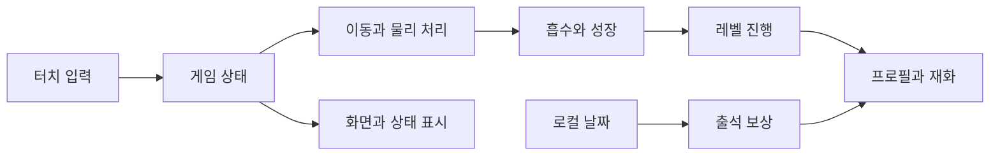

# Hole It Project · LEVEL 2 - Explorer

[LEVEL 1 - Beginner](%EB%A0%88%EB%B2%A81.md) · [LEVEL 2 - Explorer](%EB%A0%88%EB%B2%A82.md) · [LEVEL 3 - Practitioner](%EB%A0%88%EB%B2%A83.md) · [LEVEL 4 - Advanced](%EB%A0%88%EB%B2%A84.md) · [LEVEL 5 - Expert](%EB%A0%88%EB%B2%A85.md)

[같은 수준의 프로필](https://github.com/PUVKID/PUVKID/blob/main/docs/읽기안내/레벨2.md) · [프로젝트 첫 화면](../../README.md)

## LEVEL 2 · 프로젝트 소개와 읽는 방법

게임을 입력·상태·물리·진행·저장의 연결로 살펴봅니다. 같은 “물체를 먹는다”는 동작도 위치를 직접 바꾸는 초기 방식과 강체·충돌체를 유지하는 후속 방식에서 처리 경로가 다릅니다. **차수별로 바뀌는 책임과 보존 범위**를 먼저 확인하는 안내입니다.

## LEVEL 2 · 실제 기능과 동작 범위

제품 GameManager는 시작 참조 검사 후 Loading→Title→Ready→Playing으로 진행하며, 목표 완료는 Clearing→LevelClear, 시간 소진은 Failed로 이어집니다. 수집한 물체의 점수·미션·성장과 종료 판정은 연결되지만 각각 별도 상태입니다. SessionId는 한 플레이 시도를 식별해 이전 시도의 재사용 물체가 보상을 다시 주는 경로를 막는 데 쓰입니다.

Reference 계열에서는 카탈로그가 모델·레벨·배치를 연결하고 프로필과 출석이 저장 책임을 나눕니다. 8차의 목표 성장과 적용 성장 분리는 화면 게이지와 실제 크기 변경을 따로 다루는 예입니다.

## LEVEL 2 · 입력에서 처리와 출력까지

터치 입력이 게임 상태의 허용 여부를 거쳐 이동으로 전달되고, 물리·트리거 결과가 수집 처리로 연결됩니다. 수집은 미션·성장에 반영된 뒤 화면과 로컬 기록에 표시됩니다. 출석은 로컬 날짜 → 수령 가능 여부 → 코인 갱신이라는 별도 흐름입니다. PlayerPrefs는 기기 내 작은 값 저장소이며 서버 검증 기능이 아닙니다.

## LEVEL 2 · 사용·실험 순서와 확인 방법

같은 차수의 Builder·씬·카탈로그·자원을 한 묶음으로 읽습니다. 처음에는 1~2차의 미션·풀·타이머를 확인하고, 3~4차의 ReferenceCatalog·입력 변화, 5~6차의 물리·프로필·출석, 7~8차의 성장·카메라·수집 변경을 이어서 봅니다. 9차는 이 흐름의 완전한 후속 프로젝트가 아니라 제품 상태 코드 부분본으로 따로 읽습니다.

## LEVEL 2 · 결과와 한계를 해석하는 기준

설정표의 이동 속도·중력·물리 간격·카메라 값은 동작을 만드는 입력이지 측정 FPS가 아닙니다. 7차까지의 강체 풀 384개 제한과 8차의 프레임당 활성화 25개를 같은 제한으로 비교하면 안 됩니다. 정지 장면 기록과 순간 이동·시간 배속 시험도 일반 조이스틱 플레이 및 Android 성능의 근거와 다릅니다.

## LEVEL 2 · 구현과 핵심 파일을 연결해 읽기

ReferenceGame 부분 클래스는 게임 책임을 물리·레벨·화면으로 나누고 ReferenceGrowthProgress와 ReferenceGrowthRing은 성장 값과 표현을 분리합니다. Editor 제작 도구는 런타임 코드를 읽는 것과 달리 자산·씬·설정을 생성하거나 덮어쓸 수 있습니다. 아래 공통 근거에서 도구별 실제 동작과 준비 조건을 읽은 뒤 코드 비교로 이동합니다.

## LEVEL 2 · 용어와 실수하기 쉬운 구분

Unity는 화면·장면·입력·물리를 함께 구성하는 게임 제작 환경입니다. 씬은 물체와 화면을 배치한 장면이고, 에셋은 모델·그림·소리 같은 자원입니다. 강체는 중력과 충돌 계산을 받는 물체, 충돌체는 부딪히는 범위를 뜻합니다. 트리거는 범위 진입·이탈을 알려 주는 감지 장치입니다. 객체 풀은 만들어 둔 물체를 다시 쓰는 방식이고, 프레임은 화면·게임을 갱신하는 한 번의 단위입니다.

**공개 코드 보관본과 완전한 Unity 실행 프로젝트는 다릅니다.** 초기 HoleItBuilder와 후속 ReferenceBuilder 계열을 섞지 않습니다. 로컬 코인·하트·출석은 서버 결제·계정 동기화가 아니며, 과거 캐시 삭제·Gradle 복구 도구는 일반 플레이 절차로 실행하지 않습니다.

## LEVEL 2 · 전체 차수와 같은 수준의 상세 설명

차수 이름은 실제 보관 단위를 따릅니다. 부분본·시험 도구·최종 안내는 제품 버전과 구분하며, 폴더와 직전 비교를 함께 연결합니다.

| 차수·자료 | 자료 폴더 | 이 수준의 차수 설명 | 직전 비교·범위 |
| --- | --- | --- | --- |
| 1차 | [자료](../../1%EC%B0%A8) | [LEVEL 2 - Explorer](../versions/1%EC%B0%A8.md#reading-level-2) | [전체 비교](../revision-audit/1%EC%B0%A8.md) |
| 2차 | [자료](../../2%EC%B0%A8) | [LEVEL 2 - Explorer](../versions/2%EC%B0%A8.md#reading-level-2) | [전체 비교](../revision-audit/2%EC%B0%A8.md) |
| 3차 | [자료](../../3%EC%B0%A8) | [LEVEL 2 - Explorer](../versions/3%EC%B0%A8.md#reading-level-2) | [전체 비교](../revision-audit/3%EC%B0%A8.md) |
| 4차 | [자료](../../4%EC%B0%A8) | [LEVEL 2 - Explorer](../versions/4%EC%B0%A8.md#reading-level-2) | [전체 비교](../revision-audit/4%EC%B0%A8.md) |
| 5차 | [자료](../../5%EC%B0%A8) | [LEVEL 2 - Explorer](../versions/5%EC%B0%A8.md#reading-level-2) | [전체 비교](../revision-audit/5%EC%B0%A8.md) |
| 6차 | [자료](../../6%EC%B0%A8) | [LEVEL 2 - Explorer](../versions/6%EC%B0%A8.md#reading-level-2) | [전체 비교](../revision-audit/6%EC%B0%A8.md) |
| 7차 | [자료](../../7%EC%B0%A8) | [LEVEL 2 - Explorer](../versions/7%EC%B0%A8.md#reading-level-2) | [전체 비교](../revision-audit/7%EC%B0%A8.md) |
| 8차 | [자료](../../8%EC%B0%A8) | [LEVEL 2 - Explorer](../versions/8%EC%B0%A8.md#reading-level-2) | [전체 비교](../revision-audit/8%EC%B0%A8.md) |
| 9차 | [자료](../../9%EC%B0%A8) | [LEVEL 2 - Explorer](../versions/9%EC%B0%A8.md#reading-level-2) | [전체 비교](../revision-audit/9%EC%B0%A8.md) |
| 고유 작업 코드·문서 | [자료](../../%EB%B3%B4%EC%A1%B4%EC%9E%90%EB%A3%8C/%EC%9E%91%EC%97%85%EC%86%8C%EC%8A%A4) | [LEVEL 2 - Explorer](../SOURCE_MATERIALS.md#reading-level-2) | [전체 비교](../SOURCE_MATERIALS.md) |

## LEVEL 2 · 논문·원고와 원본 자료의 범위

이 저장소의 첫 화면은 게임 코드·개발 도구·실행 안내·비교 자료를 다룹니다. 게임 구현을 논문 실험 결과로 바꾸어 설명하지 않습니다. 화면·원본 자산의 출처는 아래 이미지 자료와 차수별 원문 안내에서 확인합니다.

## LEVEL 2 · 원래 모든 세부 설명으로 이동하기

설정값·코드 예제·실패 조건·측정 범위·화면과 파일별 안내를 생략하지 않도록 첫 화면의 전체 본문을 아래에 함께 둡니다. 각 항목은 이 페이지의 공통 근거로 바로 이동합니다. 원문에 담긴 이전 차수 조건을 현재 실행 조건으로 자동 적용하지 않습니다.

| 첫 화면의 원래 항목 | 이 페이지의 전체 근거 |
| --- | --- |
| Hole It Project | [전체 문단·표·코드](#source-section-1) |
| 두 구현 계열과 게임 상태 | [전체 문단·표·코드](#source-section-2) |
| 최신차수에서 달라진 점 | [전체 문단·표·코드](#source-section-3) |
| 차수 바로가기 | [전체 문단·표·코드](#source-section-4) |
| 입력·처리·출력 | [전체 문단·표·코드](#source-section-5) |
| 프로젝트 소개 | [전체 문단·표·코드](#source-section-6) |
| 저장소 구성 | [전체 문단·표·코드](#source-section-7) |
| 주요 기술과 차수 구분 | [전체 문단·표·코드](#source-section-8) |
| 1차부터 8차까지 달라진 점 | [전체 문단·표·코드](#source-section-9) |
| 성장·카메라·물리 구성 | [전체 문단·표·코드](#source-section-10) |
| 빠른 시작 | [전체 문단·표·코드](#source-section-11) |
| 게임 데이터와 설정 | [전체 문단·표·코드](#source-section-12) |
| 실행·시험 범위 | [전체 문단·표·코드](#source-section-13) |
| 편집기·시험·복구 도구를 사용할 때 | [전체 문단·표·코드](#source-section-14) |
| 문제 해결 | [전체 문단·표·코드](#source-section-15) |
| 모든 차수·보관본과 전체 차이 | [전체 문단·표·코드](#source-section-16) |
| 차수별 화면과 검증 이미지 | [전체 문단·표·코드](#source-section-17) |

## LEVEL 2 · 항목별 자세한 풀이와 확인 지점

### LEVEL 2 · 두 구현 계열과 게임 상태

GameManager는 입력·미션·레벨 참조를 모으고 ReferenceGame은 물리·레벨·화면을 부분 클래스로 나눕니다. 상태 전이와 수집·보상 조건을 먼저 그린 뒤 각 파일을 연결하면 UI 표시와 실제 게임 허용 상태를 혼동하지 않습니다.

[이 항목의 전체 조건·원문](#source-section-2)

### LEVEL 2 · 최신차수에서 달라진 점

변경의 중심은 트리거 이벤트·성장 목표/적용 단계·원형 진행 표시입니다. 강체 활성화를 나누는 처리와 총 물체 수, 렌더 유지와 물리 갱신을 각각 별도 기능으로 읽습니다.

[이 항목의 전체 조건·원문](#source-section-3)

### LEVEL 2 · 차수 바로가기

차수 번호는 보관 시점·자료 단위입니다. 코드 먼저 보기·변경 보기·실행 준비가 서로 다른 읽기 경로이며 차수별 설명과 원본 폴더를 함께 이동합니다.

[이 항목의 전체 조건·원문](#source-section-4)

### LEVEL 2 · 입력·처리·출력

입력은 게임 상태를 거쳐 이동·물리로 전달되고 수집이 성장·미션·레벨로 연결됩니다. 프로필 저장은 그 결과 일부를 기기 안에 남기는 별도 단계입니다.

[이 항목의 전체 조건·원문](#source-section-5)

### LEVEL 2 · 프로젝트 소개

미션·레벨·물리·화면·프로필·출석을 기능별로 구분합니다. 같은 게임 경험을 구성하더라도 처리 주체와 입력·저장 범위가 다릅니다.

[이 항목의 전체 조건·원문](#source-section-6)

### LEVEL 2 · 저장소 구성

8차 Source 아래 게임 중심·물리·레벨·화면·프로필·출석 파일이 있습니다. Tests와 Tools는 제품 런타임과 책임이 다르므로 파일 종류부터 나누어 읽습니다.

[이 항목의 전체 조건·원문](#source-section-7)

### LEVEL 2 · 주요 기술과 차수 구분

게임 실행 코드와 Editor 제작 도구가 한 저장소에 있지만 역할은 다릅니다. 후기 환경과 초기 차수의 프로젝트 설정을 나누고 자원·씬 의존성을 연결합니다.

[이 항목의 전체 조건·원문](#source-section-8)

### LEVEL 2 · 1차부터 8차까지 달라진 점

1~2차는 제품 초기 흐름, 3~4차는 카탈로그·입력, 5~6차는 물리·프로필·출석, 7~8차는 성장·탐색·수집 변경으로 이어집니다. 단계별 구현 책임이 어떻게 이동하는지 읽습니다.

[이 항목의 전체 조건·원문](#source-section-9)

### LEVEL 2 · 성장·카메라·물리 구성

성장 누적·적용·표현, 카메라 전환, 물리 간격을 나누어 봅니다. 목표 성장과 시각적 확대·복원은 서로 다른 시간 조건으로 연결됩니다.

[이 항목의 전체 조건·원문](#source-section-10)

### LEVEL 2 · 빠른 시작

README 확인 → 프로젝트 자원 준비 → 임포트·컴파일 → 테스트·플레이 → Android 빌드 순서입니다. 앞 단계 실패를 뒤의 빌드 명령으로 건너뛰지 않습니다.

[이 항목의 전체 조건·원문](#source-section-11)

### LEVEL 2 · 게임 데이터와 설정

출석 조회→날짜·주기 검사→수령→로컬 재화 갱신의 순서를 구분합니다. 8차 규칙은 31회 누적 출석과 1,000 코인 보상이며 같은 로컬 날짜 중복을 거부합니다. 하트 상한 5와 1,800초 회복은 보유량·시간 경로이고 승리 보상 20, 부스터 가격 1,800, 하트 충전 가격 900은 보상·구매 경로입니다. 모드별 비용 처리와 PlayerPrefs 저장을 연결해 읽되 서버 결제·계정 동기화와 혼합하지 않습니다.

조회와 수령·보유와 소비, 미션 목표와 성장 포인트를 구분합니다. 로컬 날짜와 PlayerPrefs 저장이 보상 주기·중복 수령을 제어합니다.

[이 항목의 전체 조건·원문](#source-section-12)

### LEVEL 2 · 실행·시험 범위

정적 검사·Unity 플레이·Android 성능·특수 캠페인 시험은 서로 다른 검증 층입니다. 모델·배치·글꼴 등 자원 준비와 화면 고정 문구의 의미도 구분합니다.

[이 항목의 전체 조건·원문](#source-section-13)

### LEVEL 2 · 편집기·시험·복구 도구를 사용할 때

Editor 생성·오프라인 정적 검사·캠페인 시험·캐시 삭제·Gradle 복구를 역할과 부작용으로 나눕니다. 과거 PASS 집계는 현재 환경에서 다시 성공했다는 뜻이 아닙니다.

[이 항목의 전체 조건·원문](#source-section-14)

### LEVEL 2 · 문제 해결

환경 누락·차수 불일치·자산 참조·저장 상태·시험 종류 차이를 원인별로 나눕니다. 같은 증상이라도 새로 설치·재빌드하는 한 방법으로 모두 처리하지 않습니다.

[이 항목의 전체 조건·원문](#source-section-15)

### LEVEL 2 · 모든 차수·보관본과 전체 차이

자료 폴더는 원본 위치, 상세는 기능과 조건, 전체 비교는 파일 변화입니다. 세 링크를 연결해 구현 변화와 보존 범위를 함께 읽습니다.

[이 항목의 전체 조건·원문](#source-section-16)

### LEVEL 2 · 차수별 화면과 검증 이미지

이미지 자료 목록에서 차수·출처·파일 해시와 실제 화면·합성 입력의 역할을 구분합니다. 화면과 동작·성능 검증은 근거가 다릅니다.

[이 항목의 전체 조건·원문](#source-section-17)


## LEVEL 2 · 다음에 읽을 곳

같은 관점의 [프로필](https://github.com/PUVKID/PUVKID/blob/main/docs/읽기안내/레벨2.md)에서 다른 프로젝트로 이동하거나 위 차수표에서 구현의 변화를 읽습니다. 다른 깊이가 필요하면 페이지 위의 수준 선택을 이용합니다. 수치·예제 명령·비교 파일은 아래 전체 근거와 차수별 원문에서 함께 확인합니다.

<a id="common-source"></a>
## LEVEL 2 · 공통 근거 · 첫 화면의 원래 전체 설명


<a name="️-hole-it-project"></a>
<a id="source-section-1"></a>
## Hole It Project

물체를 흡수하며 성장하는 Unity 게임입니다.

**기술 분류:** 게임 프로그래밍 › Unity 게임플레이 › 물리·흡수·성장·상태

`Unity`
`C#`
`Android`

[빠른 시작](#quick-start) · [저장소 구성](#repository-structure) · [게임 설정](#data-settings)

[핵심 구성](#input-processing-output)

<a name="implementation-details"></a>

<a name="-두-구현-계열과-게임-상태"></a>
<a id="source-section-2"></a>
## 두 구현 계열과 게임 상태

초기 제품 계열에서는 `GameManager`가 입력·미션·레벨·홀·UI 참조를 연결합니다. 후속 Reference 계열은 `ReferenceGame`의 부분 클래스로 게임·물리·레벨·화면을 나눕니다. 서로 다른 계열의 스크립트와 씬을 같은 시점 프로젝트처럼 섞지 않습니다. 보존된 8차 Reference 구현과 9차 제품 스크립트 8개는 자료 범위가 다릅니다.

제품 GameManager 코드의 상태 흐름은 다음과 같습니다.

- 시작: 필수 참조와 성장표 검사 후 Loading→Title→Ready→Playing으로 전환합니다.
- 수집과 종료: 소비한 물체의 점수·성장·미션을 반영합니다. 목표 완료는 Clearing→LevelClear, 시간 소진은 Failed로 이어집니다.
- 보상: SessionId와 보상 소유권 검사로 이전 세션의 풀링 객체가 중복 지급하는 경로를 막습니다.
- 일시정지: Pause는 시간 배율 0과 입력 중단, Resume는 배율 1과 Playing 복귀이며 포커스 상실도 일시정지합니다.

Reference 8차에서는 진입·이탈 트리거, 지연 성장, 열린 원형 게이지를 변경했습니다. 프레임당 25개 활성화와 성장 지연 0.3초는 처리 설정이며 실제 FPS나 전체 강체 수 제한을 뜻하지 않습니다.

프로필·재화·하트·출석은 로컬 게임 상태이며 서버 결제나 계정 동기화와 다릅니다.

실행에는 같은 차수의 Unity 씬·Packages·ProjectSettings·모델/텍스처·직렬화 참조가 필요합니다. 공개 C#만 있는 부분본은 코드 흐름과 비교를 읽는 자료입니다. Builder와 복구/캐시 도구는 자산을 바꿀 수 있으므로 일반 플레이 명령처럼 일괄 실행하지 않습니다. 각 차수의 카탈로그·물리·저장 클래스와 실제 전체 차이는 아래 독립 안내에서 이어집니다.

[각 차수의 코드·조건·관측·전체 비교](../REVISION_INDEX.md)


<a name="overview"></a>

<a name="latest-changes"></a>
<a name="-최신차수에서-달라진-점"></a>
<a id="source-section-3"></a>
## 최신차수에서 달라진 점

**8차 · 최신 Reference 구현 보관본** — 실제 수집 트리거·지연 성장과 열린 원형 게이지

별도 [9차 자료](../versions/9%EC%B0%A8.md#reading-level-2)는 8개 제품 스크립트의 부분 보관본입니다. 완전한 후속 Unity 프로젝트로 표시하지 않습니다.

- 모든 배치 물체의 강체·충돌체를 유지하고 ReferencePhysicsTrigger의 진입·이탈 이벤트를 전달합니다. 활성화 작업은 프레임당 25개씩 진행하며, 전체 강체 수는 이 값으로 제한하지 않습니다.
- ReferenceGrowthProgress는 목표·적용 성장 단계를 구분하고 0.3초 뒤 성장시키며 ReferenceGrowthRing은 열린 원형 게이지를 그립니다. 수집 뒤 강체 렌더 유지·승리 후 물리 갱신·전체 bounds 시야 검사가 7차와 다릅니다.

[최신 자료 자세히 보기](../versions/8%EC%B0%A8.md#reading-level-2) · [전체 차수 의미 비교](../VERSIONS.md)

<a name="-차수-바로가기"></a>
<a id="source-section-4"></a>
### 차수 바로가기

[1차](../versions/1%EC%B0%A8.md#reading-level-2) · [2차](../versions/2%EC%B0%A8.md#reading-level-2) · [3차](../versions/3%EC%B0%A8.md#reading-level-2) · [4차](../versions/4%EC%B0%A8.md#reading-level-2) · [5차](../versions/5%EC%B0%A8.md#reading-level-2) · [6차](../versions/6%EC%B0%A8.md#reading-level-2) · [7차](../versions/7%EC%B0%A8.md#reading-level-2) · [8차](../versions/8%EC%B0%A8.md#reading-level-2)

1~8차에 걸친 게임 구현과 변경 내용을 정리했습니다.

| 관심 있는 내용 | 바로가기 |
| :--- | :--- |
| 코드를 먼저 보고 싶어요 | [최신 원본 폴더](../../8%EC%B0%A8) |
| 이전과 무엇이 다른가요? | [차수별 해설과 근거](../VERSIONS.md) |
| 어떻게 실행하나요? | [준비 조건과 실행 제약](#quick-start) |


<a name="preview"></a>

<a name="input-processing-output"></a>

<a name="-입력처리출력"></a>
<a id="source-section-5"></a>
## 입력·처리·출력

| 단계 | 이 프로젝트에서 다루는 내용 |
| :--- | :--- |
| 입력 | 터치 입력·레벨 배치·물체 |
| 처리 | Unity 이동·충돌·흡수, 성장·레벨·로컬 보상 |
| 출력 | 게임 화면·진행 상태·로컬 저장 |


---

<a name="introduction"></a>

<a name="-프로젝트-소개"></a>
<a id="source-section-6"></a>
## 프로젝트 소개

구멍을 움직여 물체를 흡수하고 성장하는 게임의 개발 과정을 담았습니다.

초기 `GameManager`·미션 구조부터 후속 `ReferenceGame` 기반 구현까지 여러 차수의 게임 코드를 담았습니다. 최신 공개 코드 묶음은 게임 상태, 레벨, 물리, 화면 표현을 부분 클래스로 나누고 프로필·출석 데이터를 별도 클래스로 관리합니다.

| 기능 | 구현 내용 |
| :--- | :--- |
| 흡수·성장 | 홀의 이동과 물체 처리, 성장 표시 |
| 레벨 진행 | 캠페인과 레벨 구성·상태 관리 |
| 화면 구성 | 홈·플레이·프로필·출석·상태 표시 |
| 물리 처리 | 물체와 바닥·홀의 상호작용 |
| 재화·하트 | 코인·부스터·하트 보유와 갱신 |
| 일일 출석 | 로컬 날짜별 1회 수령과 누적 주기 |



<a name="repository-structure"></a>

<a name="-저장소-구성"></a>
<a id="source-section-7"></a>
## 저장소 구성

주요 코드 경로는 다음과 같습니다.

```text
.
├── 1차/HoleIt_Source/
├── 2차/ … 7차/
├── 8차/Source/
│   ├── Assets/Scripts/
│   │   ├── ReferenceGame.cs
│   │   ├── ReferenceGame.Levels.cs
│   │   ├── ReferenceGame.Physics.cs
│   │   ├── ReferenceGame.Presentation.cs
│   │   ├── ReferenceProfile.cs
│   │   └── ReferenceAttendance.cs
│   ├── Assets/Tests/
│   ├── Tools/
│   ├── Build-Android.ps1
│   └── README.txt
└── docs/VERSIONS.md
```

- [8차 소스](../../8%EC%B0%A8/Source), [게임 중심 코드](../../8%EC%B0%A8/Source/Assets/Scripts/ReferenceGame.cs).
- [프로필](../../8%EC%B0%A8/Source/Assets/Scripts/ReferenceProfile.cs), [출석](../../8%EC%B0%A8/Source/Assets/Scripts/ReferenceAttendance.cs).
- [원래 실행 안내](../../8%EC%B0%A8/Source/README.txt), [버전 기록](../VERSIONS.md).

<a name="implementation"></a>

<a name="-주요-기술과-차수-구분"></a>
<a id="source-section-8"></a>
## 주요 기술과 차수 구분

게임은 Unity C# 컴포넌트로 구성하고, Editor 도구로 빌드를 준비합니다. 8차 안내는 Unity `6000.3.6f1`과 Android Build Support를 전제로 합니다. 이전 `HoleItBuilder`와 후속 `ReferenceBuilder` 계열은 생성하는 게임 구성이 다르므로 서로 섞어 실행하지 않아야 합니다.

게임 코드와 개발 도구를 수록했습니다. 실행에는 해당 차수의 모델·텍스처·씬·Packages·ProjectSettings를 함께 준비해야 합니다.

<a name="️-1차부터-8차까지-달라진-점"></a>
<a id="source-section-9"></a>
### 1차부터 8차까지 달라진 점

| 차수 | 구현 변화 |
| :--- | :--- |
| 1차 | 미션 최대 3개, 객체 풀, 레벨 기록과 타이머를 갖춘 수집 프로토타입. Transform 기반 끌기·낙하와 반지름 보간 |
| 2차 | 쌓인 물체의 중력·깨우기와 월드 좌표 드래그, 폭탄 소비 실패, 폭탄 처리 중 승리 유예 |
| 3~4차 | ReferenceCatalog 기반 모델·배치·목표, 최대 1,023개 단위 묶음 렌더링과 30레벨 상한. 3차 터치 중 조이스틱에서 4차 상시 표시로 변경 |
| 5차 | 별도 LocalPhysics3D 장면과 강체 풀 384개, 비동기 로딩, 로컬 코인·하트·부스터 상점 |
| 6차 | TMP 글꼴, 챌린지·3D 도감·31일 출석, 배치 장애물과 랜덤 폭탄 |
| 7차 | 성장 단계별 속도·카메라 전환, 첫 입력부터 시작하는 타이머, 가까운 목표 최대 5개를 0.1초마다 탐색 |
| 8차 | 모든 배치 물체의 강체·충돌체 유지, 실제 트리거 수집 이벤트, 지연 성장과 열린 원형 게이지, 전체 경계 상자를 이용한 시야 검사 |

8차의 프레임당 활성화 25개는 전체 강체 수 제한이 아닙니다. 7차까지 남아 있던 강체 풀 384개 제한과 일부 원격 물체의 대체 낙하를 8차의 동작으로 설명하지 않습니다. 초기 직교 카메라와 후기 원근 카메라, 1차 이동 속도 8과 7차 이후 기본 속도 2.6도 서로 다른 구현입니다.

<a name="-성장카메라물리-구성"></a>
<a id="source-section-10"></a>
### 성장·카메라·물리 구성

8차 `ReferenceGrowthProgress`는 수집 점수를 누적하고 0.3초 뒤 다음 성장 단계를 적용합니다. 진행 링은 128분할 메시로 그리며, `ReferencePhysicsTrigger`는 진입·이탈 이벤트를 게임 소유자에게 전달합니다.

| 설정 | 후속 Reference 코드 값 |
| :--- | :--- |
| 물리 성장 단계 상한 | 10 |
| 이동 속도 | 시작 2.6, 단계당 0.442 증가, 부스트 계수 1.3 |
| 카메라 시야각 | 25 → 44, 전환 0.3초 |
| 중력·물리 간격 | 35, 0.02초 |
| 성장 표현 | 0.3초 확대 후 0.15초 복원 |

일부 구현 주석은 참조한 원본 데이터와 RVA를 기록합니다. Android 빌드 스크립트의 500MB 조건은 전체 에셋을 포함한 패키지의 크기 검사입니다.

<a name="quick-start"></a>

<a name="-빠른-시작"></a>
<a id="source-section-11"></a>
## 빠른 시작

1. `8차/Source/README.txt`와 사용할 차수의 구현을 먼저 확인합니다.
2. Unity 프로젝트에서 해당 차수의 씬·리소스·Packages·ProjectSettings를 함께 준비합니다.
3. Unity Editor에서 임포트·컴파일 오류를 확인한 뒤 프로젝트의 테스트와 플레이 검증을 수행합니다.
4. Android 빌드에는 해당 Editor의 Android 모듈·SDK·NDK·JDK가 필요합니다.

완전한 8차 프로젝트를 준비한 환경에서 제공된 빌드 진입점은 다음과 같습니다.

```powershell
cd "8차/Source"
.\Build-Android.ps1 -UnityPath "C:\Program Files\Unity\Hub\Editor\6000.3.6f1\Editor\Unity.exe"
```

빌드에는 소스 외에 해당 차수의 씬·에셋·프로젝트 설정이 필요합니다. 스크립트는 전체 에셋을 포함한 원본 패키지의 APK 크기 조건도 검사합니다.

<a name="data-settings"></a>

<a name="-게임-데이터와-설정"></a>
<a id="source-section-12"></a>
## 게임 데이터와 설정

| 항목 | 8차 코드의 값·처리 |
| :--- | :--- |
| 출석 주기 | 31회 누적 |
| 출석 보상 | 1,000 게임 코인 |
| 중복 수령 | 같은 로컬 날짜 재수령 거부 |
| 하트 상한 | 5 |
| 하트 회복 간격 | 1,800초 |
| 승리 보상 상수 | 20 |
| 부스터 가격 상수 | 1,800 |
| 하트 충전 가격 상수 | 900 |

코인·하트·잠금 해제·부스터·출석 상태는 로컬 PlayerPrefs에 저장합니다. 실제 결제나 서버 재화 연동은 구현 범위에 포함되지 않습니다. 무료 플레이·챌린지·일반 캠페인은 비용 처리 방식이 다릅니다. 미션 목표 수와 수집 성장 포인트도 별도로 관리합니다.

출석 조회는 보상을 소비하지 않고, 수령 함수가 날짜·주기와 재화를 갱신합니다. 이는 기기 로컬 날짜를 사용하는 구현이며 서버 검증형 보상 시스템은 아닙니다. 초기 차수의 성장 표·미션·레벨 수를 후속 차수에 그대로 적용하지 않습니다.

<a name="-실행시험-범위"></a>
<a id="source-section-13"></a>
### 실행·시험 범위

Unity 컴파일과 플레이 검증, Android 빌드와 실제 기기 성능 평가는 각 실행 환경에서 수행합니다.

후기 실행에는 ReferenceCatalog와 모델·충돌 메시·배치/장애물 메타데이터, 스타일·음원·글꼴·TMP 텍스트 프리셋이 필요합니다. 화면의 `465레벨`·`1,010물체` 문구는 공개 사본의 실제 자산 수를 보증하지 않습니다. 일부 코드가 원본 데이터·배치를 참조하므로 모든 모델과 그림을 직접 제작한 것으로 설명하지 않습니다.

Windows 캡처·시험 도구에는 버튼 호출, 폭탄 배치, QA 저장 상태 초기화와 시험용 이동이 포함됩니다. 사용하는 차수의 도구를 확인하고 별도 시험 상태에서 실행해야 합니다. 정지 장면 180프레임 기록과 순간 이동·시간 가속을 사용한 기능 시험을 제공합니다. Android 성능과 일반 조이스틱 플레이는 별도로 평가합니다.

<a name="️-편집기시험복구-도구를-사용할-때"></a>
<a id="source-section-14"></a>
### 편집기·시험·복구 도구를 사용할 때

| 도구 묶음 | 실제 동작과 준비 조건 |
| :--- | :--- |
| Editor 제작 도구 | 메시·텍스처·프리팹·레벨·씬·프로젝트 설정을 생성하거나 덮어씁니다. 선택한 차수의 에셋과 함께 사용해야 합니다. |
| 오프라인 정적 검사 | 설정·참조·메시·UI 계산 등을 확인하지만 C# 컴파일·PhysX·실제 기기 플레이까지 실행하는 검사는 아닙니다. |
| 캠페인 시험 | 순간 이동·반복 탐색·시간 배속·reflection을 사용하는 경로가 있어 정상 조이스틱 조작 완주와 구분해야 합니다. |
| 이전 캐시 정리 | `cleanup_editor_cache.ps1`은 별도 적용 스위치 없이 조건 확인 뒤 `Library`의 `Bee` 외 직계 항목을 삭제합니다. 일반적인 확인 명령으로 실행하면 안 됩니다. |
| 후속 캐시 정리 | `cleanup_editor_cache-fresh2abi.ps1`은 기본 계획 출력, `-Apply`에서 명시한 캐시만 삭제하며 연결 경로와 후손을 검사합니다. 특정 원래 빌드 증거에 의존합니다. |
| Gradle 복구·시험 집계 | 원래 경로·로그·빌드 증거에 결합된 도구입니다. 집계된 과거 PASS는 현재 소스의 새 전체 시험 성공을 뜻하지 않습니다. |

[7차 검증 도구](../../7%EC%B0%A8/Verification)는 원래 사건의 복구용 자료를 포함합니다. `fresh2abi` 도구 역시 임의 환경에 바로 적용하는 범용 복구 프로그램이 아닙니다. 이 저장소를 정리하는 동안 캐시 삭제·Gradle 복구·Unity 시험을 실행하지 않았습니다.

<a name="troubleshooting"></a>

<a name="️-문제-해결"></a>
<a id="source-section-15"></a>
## 문제 해결

| 증상 | 확인할 내용 |
| :--- | :--- |
| Unity 프로젝트로 열리지 않음 | 누락된 Packages·ProjectSettings·씬·리소스 준비 여부 |
| 이전 게임 구성이 생성됨 | 실행한 Builder가 선택한 차수와 일치하는지 확인 |
| Android 빌드 실패 | Unity 버전과 Android Build Support 구성 |
| 출석 보상을 다시 받지 못함 | 같은 로컬 날짜의 수령 여부 |
| 화면·에셋 참조 오류 | 해당 차수의 리소스와 스크립트 조합 |
| 테스트와 기기 동작이 다름 | 소스 테스트·Editor 플레이·실기기 검증을 구분 |

---

<div align="center">

**움직이고, 흡수하고, 성장하는 플레이를 만듭니다.**

</div>

<!-- apps-revision-audit -->
<a name="-모든-차수보관본과-전체-차이"></a>
<a id="source-section-16"></a>
## 모든 차수·보관본과 전체 차이

각 차수의 소스·설정·리소스·사용법·설계를 함께 보관합니다. 부분 자료와 실제 제품 버전을 각 설명에서 구분합니다.

| 차수·자료 | 자료 폴더·원본 | 상세 설명 | 직전 비교·범위 |
|---|---|---|---|
| 1차 | [자료 폴더](../../1%EC%B0%A8) | [상세 설명](../versions/1%EC%B0%A8.md#reading-level-2) | [전체 비교·범위](../revision-audit/1%EC%B0%A8.md) |
| 2차 | [자료 폴더](../../2%EC%B0%A8) | [상세 설명](../versions/2%EC%B0%A8.md#reading-level-2) | [전체 비교·범위](../revision-audit/2%EC%B0%A8.md) |
| 3차 | [자료 폴더](../../3%EC%B0%A8) | [상세 설명](../versions/3%EC%B0%A8.md#reading-level-2) | [전체 비교·범위](../revision-audit/3%EC%B0%A8.md) |
| 4차 | [자료 폴더](../../4%EC%B0%A8) | [상세 설명](../versions/4%EC%B0%A8.md#reading-level-2) | [전체 비교·범위](../revision-audit/4%EC%B0%A8.md) |
| 5차 | [자료 폴더](../../5%EC%B0%A8) | [상세 설명](../versions/5%EC%B0%A8.md#reading-level-2) | [전체 비교·범위](../revision-audit/5%EC%B0%A8.md) |
| 6차 | [자료 폴더](../../6%EC%B0%A8) | [상세 설명](../versions/6%EC%B0%A8.md#reading-level-2) | [전체 비교·범위](../revision-audit/6%EC%B0%A8.md) |
| 7차 | [자료 폴더](../../7%EC%B0%A8) | [상세 설명](../versions/7%EC%B0%A8.md#reading-level-2) | [전체 비교·범위](../revision-audit/7%EC%B0%A8.md) |
| 8차 | [자료 폴더](../../8%EC%B0%A8) | [상세 설명](../versions/8%EC%B0%A8.md#reading-level-2) | [전체 비교·범위](../revision-audit/8%EC%B0%A8.md) |
| 9차 | [자료 폴더](../../9%EC%B0%A8) | [상세 설명](../versions/9%EC%B0%A8.md#reading-level-2) | [전체 비교·범위](../revision-audit/9%EC%B0%A8.md) |
| 고유 작업 코드·문서 | [자료 폴더](../../%EB%B3%B4%EC%A1%B4%EC%9E%90%EB%A3%8C/%EC%9E%91%EC%97%85%EC%86%8C%EC%8A%A4) | [상세 설명](../SOURCE_MATERIALS.md#reading-level-2) | [전체 비교·범위](../SOURCE_MATERIALS.md) |


<a name="️-차수별-화면과-검증-이미지"></a>
<a id="source-section-17"></a>
### 차수별 화면과 검증 이미지

[원문 이미지·차수별 출처·파일 해시](../IMAGE_MATERIALS.md)에서 화면과 합성 테스트 입력을 확인할 수 있습니다.


[전체 차수와 자료](../REVISION_INDEX.md)
