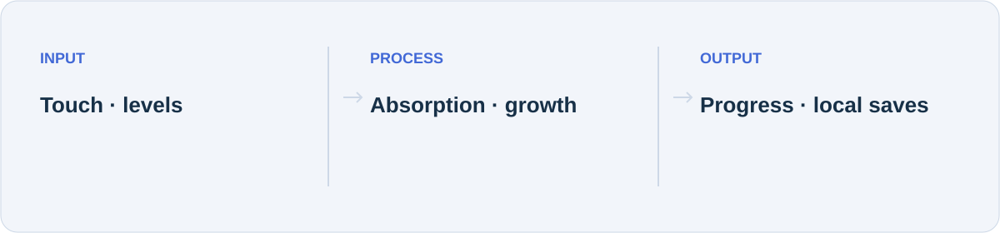
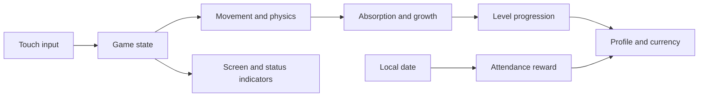

<a name="️-hole-it-project"></a>
<a id="hole-it-project"></a>
<!-- readme-header32:start -->
<p align="center"></p>
<h1 align="center" id="project-title">Hole It Project</h1>
<p align="center">A Unity game built around absorption and growth</p>
<p align="center">
  <a href="../README.md"></a>
  <a href="README.md"></a>
</p>
<p align="center">
  <a href="../docs/읽기안내/레벨1.md"></a>
  <a href="../docs/읽기안내/레벨2.md"></a>
  <a href="../docs/읽기안내/레벨3.md"></a>
  <a href="../docs/읽기안내/레벨4.md"></a>
  <a href="../docs/읽기안내/레벨5.md"></a>
</p>
<p align="center"><small>LEVEL links open the Korean source at the same reading level.</small></p>
<picture>
  <source media="(max-width: 600px) and (prefers-color-scheme: dark)" srcset="../assets/readme/flow-en-dark-mobile.svg" />
  <source media="(max-width: 600px)" srcset="../assets/readme/flow-en-light-mobile.svg" />
  <source media="(prefers-color-scheme: dark)" srcset="../assets/readme/flow-en-dark.svg" />
  <source media="(prefers-color-scheme: light)" srcset="../assets/readme/flow-en-light.svg" />
  
</picture>
<!-- readme-header32:end -->


A Unity game in which you grow by absorbing objects.

<!-- project-levels:start -->
<a id="읽는-수준-선택"></a>
## Choose a reading level

| Level | What this guide covers |
| --- | --- |
| [LEVEL 1 - Beginner (Korean source)](../docs/읽기안내/레벨1.md) | Unfamiliar terms explained alongside actual behavior, examples, and easily misunderstood limits. |
| [LEVEL 2 - Explorer (Korean source)](../docs/읽기안내/레벨2.md) | Inputs, processing, outputs, connections between features, and changes across revisions. |
| [LEVEL 3 - Practitioner (Korean source)](../docs/읽기안내/레벨3.md) | Prerequisites, usage steps, settings, results, and how to check failures. |
| [LEVEL 4 - Advanced (Korean source)](../docs/읽기안내/레벨4.md) | Module design, state transitions, verification boundaries, and implementation choices. |
| [LEVEL 5 - Expert (Korean source)](../docs/읽기안내/레벨5.md) | Actual code, protocols, settings, full comparisons, and measurement evidence. |

Every guide covers the same project and all revisions. The existing detailed body is retained below.
<!-- project-levels:end -->

**Technical category:** Game programming › Unity gameplay › physics, absorption, growth, and state

`Unity`
`C#`
`Android`

[Quick start](#quick-start) · [Repository structure](#repository-structure) · [Game settings](#data-settings)

[Core structure](#input-processing-output)

<a name="implementation-details"></a>
<a name="-두-구현-계열과-게임-상태"></a>
<a id="두-구현-계열과-게임-상태"></a>
## Two implementation families and game states

In the early product family, `GameManager` connects input, missions, levels, the hole, and UI references.

The later Reference family separates gameplay, physics, levels, and presentation through partial classes of `ReferenceGame`.

Scripts and scenes from different families should not be mixed as though they belonged to the same project state.

The preserved revision 8 Reference implementation and the 8 product scripts in revision 9 have different material scopes.

The product GameManager state flow is as follows.

- Startup: after checking required references and the growth table, transitions through Loading → Title → Ready → Playing.
- Collection and ending: applies the consumed object's score, growth, and mission effects. Completing the goal leads through Clearing → LevelClear; running out of time leads to Failed.
- Rewards: SessionId and reward-ownership checks block duplicate grants by pooled objects from previous sessions.
- Pause: Pause sets the time scale to 0 and stops input; Resume restores a scale of 1 and returns to Playing. Losing focus also pauses the game.

Reference revision 8 changes entry/exit triggers, delayed growth, and an open circular gauge. Activating 25 objects per frame and a 0.3-second growth delay are processing settings; they do not indicate actual FPS or a limit on the total number of rigidbodies.

Profiles, currency, hearts, and attendance are local game state, distinct from server payments or account synchronization.

Running requires the Unity scenes, Packages, ProjectSettings, models/textures, and serialized references from the same revision.

Partial copies containing only public C# are materials for reading code flows and comparisons.

Builders and recovery/cache tools can change assets and should not be run together as ordinary play commands.

The independent guides below connect each revision's catalog, physics, and storage classes to its actual full differences.

[Code, conditions, observations, and full comparisons for every revision (Korean source)](../docs/REVISION_INDEX.md)

<a name="overview"></a>
<a name="latest-changes"></a>
<a name="-최신차수에서-달라진-점"></a>
<a id="최신차수에서-달라진-점"></a>
## What changed in the latest revision

**Revision 8 · latest preserved Reference implementation** — actual collection triggers, delayed growth, and an open circular gauge

The separate [revision 9 materials (Korean source)](../docs/versions/9차.md) are a partial archive of 8 product scripts. They are not presented as a complete subsequent Unity project.

- Retains the rigidbodies and colliders of all placed objects and forwards ReferencePhysicsTrigger entry/exit events. Activation proceeds at 25 objects per frame; this value does not limit the total number of rigidbodies.
- ReferenceGrowthProgress distinguishes target and applied growth stages and applies growth after 0.3 seconds; ReferenceGrowthRing draws an open circular gauge. Retaining rigidbody rendering after collection, updating physics after victory, and checking visibility using full bounds differ from revision 7.

[Latest materials in detail (Korean source)](../docs/versions/8%EC%B0%A8.md) · [Semantic comparison of all revisions (Korean source)](../docs/VERSIONS.md)

<a name="-차수-바로가기"></a>
<a id="차수-바로가기"></a>
### Revision shortcuts

[Revision 1 (Korean source)](../docs/versions/1%EC%B0%A8.md) · [Revision 2 (Korean source)](../docs/versions/2%EC%B0%A8.md) · [Revision 3 (Korean source)](../docs/versions/3%EC%B0%A8.md) · [Revision 4 (Korean source)](../docs/versions/4%EC%B0%A8.md) · [Revision 5 (Korean source)](../docs/versions/5%EC%B0%A8.md) · [Revision 6 (Korean source)](../docs/versions/6%EC%B0%A8.md) · [Revision 7 (Korean source)](../docs/versions/7%EC%B0%A8.md) · [Revision 8 (Korean source)](../docs/versions/8%EC%B0%A8.md)

Documents game implementations and changes across revisions 1–8.

| Interest | Shortcut |
| --- | --- |
| Read the code first | [Latest original folder (Korean source)](../8%EC%B0%A8/) |
| What changed from before? | [Revision explanations and evidence (Korean source)](../docs/VERSIONS.md) |
| How do I run it? | [Prerequisites and execution constraints](#quick-start) |

<a name="preview"></a>
<a name="input-processing-output"></a>
<a name="-입력처리출력"></a>
<a id="입력처리출력"></a>
## Input, processing, and output

| Stage | What this project covers |
| --- | --- |
| Input | Touch input, level layouts, and objects |
| Processing | Unity movement, collisions, absorption, growth, levels, and local rewards |
| Output | Game screen, progress state, and local saving |

---

<a name="introduction"></a>
<a name="-프로젝트-소개"></a>
<a id="프로젝트-소개"></a>
## Project introduction

This project records the development of a game where you move a hole, absorb objects, and grow.

It contains multiple revisions of game code, from the early `GameManager` and mission structure to later `ReferenceGame` implementations. The latest public code package divides game state, levels, physics, and presentation into partial classes and manages profile and attendance data in separate classes.

| Feature | Implementation |
| --- | --- |
| Absorption and growth | Hole movement, object processing, and growth indicators |
| Level progression | Campaign and level configuration and state management |
| Screen structure | Home, play, profile, attendance, and status indicators |
| Physics | Interactions between objects, the floor, and the hole |
| Currency and hearts | Coin, booster, and heart holdings and updates |
| Daily attendance | One claim per local date and a cumulative cycle |



<a name="repository-structure"></a>
<a name="-저장소-구성"></a>
<a id="저장소-구성"></a>
## Repository structure

The main code paths are as follows.

```text
.
├── 1차/HoleIt_Source/
├── 2차/ … 7차/
├── 8차/Source/
│   ├── Assets/Scripts/
│   │   ├── ReferenceGame.cs
│   │   ├── ReferenceGame.Levels.cs
│   │   ├── ReferenceGame.Physics.cs
│   │   ├── ReferenceGame.Presentation.cs
│   │   ├── ReferenceProfile.cs
│   │   └── ReferenceAttendance.cs
│   ├── Assets/Tests/
│   ├── Tools/
│   ├── Build-Android.ps1
│   └── README.txt
└── docs/VERSIONS.md
```

- [Revision 8 source (Korean source)](../8차/Source/), [central game code (Korean source)](../8차/Source/Assets/Scripts/ReferenceGame.cs).
- [Profile (Korean source)](../8차/Source/Assets/Scripts/ReferenceProfile.cs), [attendance (Korean source)](../8차/Source/Assets/Scripts/ReferenceAttendance.cs).
- [Original execution instructions (Korean source)](../8차/Source/README.txt), [version history (Korean source)](../docs/VERSIONS.md).

<a name="implementation"></a>
<a name="-주요-기술과-차수-구분"></a>
<a id="주요-기술과-차수-구분"></a>
## Main technologies and revision distinctions

The game consists of Unity C# components, with Editor tools for build preparation. Revision 8 instructions assume Unity `6000.3.6f1` and Android Build Support.

The earlier `HoleItBuilder` and later `ReferenceBuilder` families generate different game configurations and must not be mixed when running them.

Game code and development tools are included. Execution requires models, textures, scenes, Packages, and ProjectSettings from the corresponding revision.

<a name="️-1차부터-8차까지-달라진-점"></a>
<a id="1차부터-8차까지-달라진-점"></a>
### Changes from revision 1 through revision 8

**Revision:** 1

**Implementation changes:** A collection prototype with up to 3 missions, object pooling, level records, and a timer. Transform-based pulling/falling and radius interpolation.

**Revision:** 2

**Implementation changes:** Gravity and waking for stacked objects, world-coordinate dragging, failure when consuming bombs, and deferred victory during bomb processing.

**Revision:** 3–4

**Implementation changes:** ReferenceCatalog-based models, placement, and goals; batched rendering in groups of up to 1,023 and a 30-level cap. Changes from a joystick shown during touch in revision 3 to an always-visible joystick in revision 4.

**Revision:** 5

**Implementation changes:** A separate LocalPhysics3D scene, a 384-rigidbody pool, asynchronous loading, and a local coin/heart/booster shop.

**Revision:** 6

**Implementation changes:** TMP fonts, challenges, a 3D collection catalog, 31-day attendance, placed obstacles, and random bombs.

**Revision:** 7

**Implementation changes:** Speed/camera transitions by growth stage, a timer starting with the first input, and searching for up to 5 nearby targets every 0.1 seconds.

**Revision:** 8

**Implementation changes:** Retains rigidbodies/colliders for all placed objects, actual trigger-based collection events, delayed growth, an open circular gauge, and visibility checks using full bounding boxes.

Revision 8 activation of 25 objects per frame is not a total rigidbody cap. The 384-rigidbody pool limit and substitute falling of some remote objects that remained through revision 7 are not described as revision 8 behavior. The early orthographic camera and later perspective camera, and revision 1 movement speed of 8 versus the default 2.6 from revision 7 onward, also belong to different implementations.

<a name="-성장카메라물리-구성"></a>
<a id="성장카메라물리-구성"></a>
### Growth, camera, and physics configuration

Revision 8 `ReferenceGrowthProgress` accumulates collection scores and applies the next growth stage after 0.3 seconds. The progress ring uses a 128-segment mesh, and `ReferencePhysicsTrigger` forwards entry/exit events to the game owner.

| Setting | Later Reference code value |
| --- | --- |
| Physical growth-stage cap | 10 |
| Movement speed | Starts at 2.6, increases by 0.442 per stage, boost multiplier 1.3 |
| Camera field of view | 25 → 44, transition 0.3 seconds |
| Gravity and physics interval | 35, 0.02 seconds |
| Growth presentation | Enlarges for 0.3 seconds, then restores over 0.15 seconds |

Some implementation comments record referenced original data and RVAs. The Android build script's 500MB condition checks the size of the package including all assets.

<a name="quick-start"></a>
<a name="-빠른-시작"></a>
<a id="빠른-시작"></a>
## Quick start

1. First check `8차/Source/README.txt` and the implementation of the revision you will use.
2. Prepare that revision's scenes, resources, Packages, and ProjectSettings together in a Unity project.
3. Check import/compiler errors in Unity Editor, then run the project's tests and play checks.
4. Android builds require that Editor's Android module, SDK, NDK, and JDK.

The provided build entry point, in an environment with the complete revision 8 project prepared, is:

```powershell
cd "8차/Source"
.\Build-Android.ps1 -UnityPath "C:\Program Files\Unity\Hub\Editor\6000.3.6f1\Editor\Unity.exe"
```

Besides the source, the build requires that revision's scenes, assets, and project settings. The script also checks the APK size condition for the original package including all assets.

<a name="data-settings"></a>
<a name="-게임-데이터와-설정"></a>
<a id="게임-데이터와-설정"></a>
## Game data and settings

| Item | Revision 8 code value or behavior |
| --- | --- |
| Attendance cycle | 31 cumulative claims |
| Attendance reward | 1,000 game coins |
| Duplicate claims | Rejects another claim on the same local date |
| Heart cap | 5 |
| Heart recovery interval | 1,800 seconds |
| Victory reward constant | 20 |
| Booster price constant | 1,800 |
| Heart refill price constant | 900 |

Coins, hearts, unlocks, boosters, and attendance state are stored in local PlayerPrefs. Actual payments or server-linked currency are outside the implementation scope. Free play, challenges, and the normal campaign handle costs differently. Mission target counts and collection growth points are also managed separately.

Querying attendance does not consume a reward; the claim function updates the date, cycle, and currency. This implementation uses the device's local date and is not a server-validated reward system. Early revisions' growth tables, missions, and level counts should not be applied unchanged to later revisions.

<a name="-실행시험-범위"></a>
<a id="실행시험-범위"></a>
### Execution and testing scope

Unity compilation and play checks, Android builds, and actual-device performance evaluation are performed in their respective execution environments.

Later implementations require ReferenceCatalog, models, collision meshes, placement/obstacle metadata, styles, audio, fonts, and TMP text presets.

The on-screen labels `465 levels` and `1,010 objects` do not guarantee the actual asset counts in the public copy.

Some code references original data and layouts, so not all models and graphics are described as independently created.

Windows capture/testing tools include button invocation, bomb placement, resetting QA save state, and test movement.

Check the tools for the revision being used and run them in a separate test state.

Records of 180 frames of a stationary scene and functional tests using teleportation and accelerated time are provided.

Android performance and normal joystick play are evaluated separately.

<a name="️-편집기시험복구-도구를-사용할-때"></a>
<a id="편집기시험복구-도구를-사용할-때"></a>
### Using Editor, testing, and recovery tools

**Tool group:** Editor authoring tools

**Actual behavior and prerequisites:** Generate or overwrite meshes, textures, prefabs, levels, scenes, and project settings. Use with the assets of the selected revision.

**Tool group:** Offline static checks

**Actual behavior and prerequisites:** Check settings, references, meshes, UI calculations, and similar items, but do not perform C# compilation, PhysX execution, or actual-device play.

**Tool group:** Campaign tests

**Actual behavior and prerequisites:** Some paths use teleportation, repeated searches, time scaling, and reflection; distinguish these from completing the game with normal joystick controls.

**Tool group:** Earlier cache cleanup

**Actual behavior and prerequisites:** `cleanup_editor_cache.ps1` deletes direct children of `Library` other than `Bee` after checking conditions, without a separate apply switch. Do not run it as a routine inspection command.

**Tool group:** Later cache cleanup

**Actual behavior and prerequisites:** `cleanup_editor_cache-fresh2abi.ps1` prints a plan by default and deletes only the specified caches with `-Apply`, checking linked paths and descendants. It depends on specific original build evidence.

**Tool group:** Gradle recovery and test aggregation

**Actual behavior and prerequisites:** These tools are bound to original paths, logs, and build evidence. Aggregated historical PASS results do not mean that a new full test of the current source succeeded.

[Revision 7 verification tools (Korean source)](../7차/Verification/) include recovery materials for the original incident. The `fresh2abi` tools are likewise not general-purpose recovery programs to apply directly in arbitrary environments. Cache deletion, Gradle recovery, and Unity tests were not run while organizing this repository.

<a name="troubleshooting"></a>
<a name="️-문제-해결"></a>
<a id="문제-해결"></a>
## Troubleshooting

| Symptom | What to check |
| --- | --- |
| Does not open as a Unity project | Whether missing Packages, ProjectSettings, scenes, and resources have been prepared |
| An earlier game configuration is generated | Whether the Builder you ran matches the selected revision |
| Android build fails | Unity version and Android Build Support configuration |
| Cannot claim attendance reward again | Whether it was already claimed on the same local date |
| Screen or asset reference errors | The combination of resources and scripts for that revision |
| Tests and device behavior differ | Distinguish source tests, Editor play, and actual-device checks |

---

<div align="center">

Creating play through movement, absorption, and growth.

</div>

<!-- apps-revision-audit -->
<a name="-모든-차수보관본과-전체-차이"></a>
<a id="모든-차수보관본과-전체-차이"></a>
## All revisions, archives, and full differences

Source, settings, resources, usage instructions, and design are preserved together for every revision. Each description distinguishes partial materials from actual product versions.

| Revision/material | Material folder/original | Detailed description · preceding comparison and scope |
| --- | --- | --- |
| Revision 1 | [Material folder (Korean source)](../1%EC%B0%A8) | [Detailed description (Korean source)](../docs/versions/1%EC%B0%A8.md)<br>[Full comparison and scope (Korean source)](../docs/revision-audit/1%EC%B0%A8.md) |
| Revision 2 | [Material folder (Korean source)](../2%EC%B0%A8) | [Detailed description (Korean source)](../docs/versions/2%EC%B0%A8.md)<br>[Full comparison and scope (Korean source)](../docs/revision-audit/2%EC%B0%A8.md) |
| Revision 3 | [Material folder (Korean source)](../3%EC%B0%A8) | [Detailed description (Korean source)](../docs/versions/3%EC%B0%A8.md)<br>[Full comparison and scope (Korean source)](../docs/revision-audit/3%EC%B0%A8.md) |
| Revision 4 | [Material folder (Korean source)](../4%EC%B0%A8) | [Detailed description (Korean source)](../docs/versions/4%EC%B0%A8.md)<br>[Full comparison and scope (Korean source)](../docs/revision-audit/4%EC%B0%A8.md) |
| Revision 5 | [Material folder (Korean source)](../5%EC%B0%A8) | [Detailed description (Korean source)](../docs/versions/5%EC%B0%A8.md)<br>[Full comparison and scope (Korean source)](../docs/revision-audit/5%EC%B0%A8.md) |
| Revision 6 | [Material folder (Korean source)](../6%EC%B0%A8) | [Detailed description (Korean source)](../docs/versions/6%EC%B0%A8.md)<br>[Full comparison and scope (Korean source)](../docs/revision-audit/6%EC%B0%A8.md) |
| Revision 7 | [Material folder (Korean source)](../7%EC%B0%A8) | [Detailed description (Korean source)](../docs/versions/7%EC%B0%A8.md)<br>[Full comparison and scope (Korean source)](../docs/revision-audit/7%EC%B0%A8.md) |
| Revision 8 | [Material folder (Korean source)](../8%EC%B0%A8) | [Detailed description (Korean source)](../docs/versions/8%EC%B0%A8.md)<br>[Full comparison and scope (Korean source)](../docs/revision-audit/8%EC%B0%A8.md) |
| Revision 9 | [Material folder (Korean source)](../9%EC%B0%A8) | [Detailed description (Korean source)](../docs/versions/9%EC%B0%A8.md)<br>[Full comparison and scope (Korean source)](../docs/revision-audit/9%EC%B0%A8.md) |
| Unique working code and documents | [Material folder (Korean source)](../%EB%B3%B4%EC%A1%B4%EC%9E%90%EB%A3%8C/%EC%9E%91%EC%97%85%EC%86%8C%EC%8A%A4) | [Detailed description (Korean source)](../docs/SOURCE_MATERIALS.md)<br>[Full comparison and scope (Korean source)](../docs/SOURCE_MATERIALS.md) |

<a name="️-차수별-화면과-검증-이미지"></a>
<a id="차수별-화면과-검증-이미지"></a>
### Screens and verification images by revision

[Original images, revision-specific sources, and file hashes (Korean source)](../docs/IMAGE_MATERIALS.md) provide screens and synthetic test inputs.

[All revisions and materials (Korean source)](../docs/REVISION_INDEX.md)
